# 💣 Modern Minesweeper — Proyek DevSecOps Cloud-Native

<p align="center">
  <a href="./README.md">English</a> | <strong>Bahasa Indonesia</strong>
</p>

<p align="center">
  
</p>

<p align="center">
  
  
  
  <br />
  
  
  
  
  
  
</p>

---

## 📌 Ringkasan Proyek

Repositori ini menyimpan **Layanan Aplikasi (*Application Service*)** dari **Proyek DevSecOps Kubernetes Cloud-Native** berstandar enterprise.

Meskipun menyajikan aplikasi web yang interaktif dan kaya fitur menggunakan React 18, TypeScript, dan Tailwind CSS, repositori ini secara khusus dirancang untuk beroperasi sebagai beban kerja produksi (*production workload*) di dalam ekosistem DevSecOps yang terintegrasi. Proyek ini mengintegrasikan pengujian otomatis, kontainerisasi, *static application security testing* (SAST), pemindaian kerentanan CVE, *continuous delivery* berbasis GitOps, serta observabilitas sistem pada infrastruktur kluster multi-node.

---

## 📂 Arsitektur GitOps Dua Repositori

Sistem ini menerapkan standar pemisahan tanggung jawab (*separation of concerns*) antara kode sumber aplikasi dan konfigurasi infrastruktur melalui model dua repositori:

```
┌────────────────────────────────────────────────────────────────────────┐
│                   MODEL GITOPS DUA REPOSITORI TERPISAH                 │
├──────────────────────────────────┬─────────────────────────────────────┤
│ 📦 REPO APLIKASI (REPO INI)      │ ⚙️ REPO INFRASTRUKTUR & GITOPS      │
│ Application Service & Pipeline CI│ Infrastructure as Code & GitOps     │
├──────────────────────────────────┼─────────────────────────────────────┤
│ • Source Code React + TypeScript │ • Terraform (IaC Provisioning VPS)  │
│ • Unit Tests & Coverage (Vitest) │ • Ansible (Konfigurasi Server)      │
│ • Kontainerisasi Produksi        │ • Setup Kluster K3s (Master/Worker) │
│ • Konfigurasi Web Server Nginx   │ • Manifest Deklaratif Kubernetes    │
│ • Pipeline CI Deklaratif         │ • Konfigurasi Sinkronisasi Argo CD  │
│ • Pemindaian Keamanan Otomatis   │ • Telemetri Prometheus & Grafana    │
└──────────────────────────────────┴─────────────────────────────────────┘
```

- **Repositori Aplikasi (`devsecops-minesweeper-typescript` — *Repositori Ini*)**  
  Bertanggung jawab atas pengembangan fitur aplikasi, pengujian unit komprehensif, pengemasan kontainer multi-stage, pemindaian keamanan, dan publikasi image terversi (dengan tag Git commit SHA) ke Docker Hub.
- **Repositori Infrastruktur & GitOps (`devops-infrastructure` — *Repositori Terpisah*)**  
  Bertanggung jawab atas provisioning server VPS via Terraform, otomatisasi konfigurasi server dengan Ansible, pemeliharaan berkas manifest Kubernetes (`Deployment`, `Service`, `Ingress`), serta manajemen *continuous delivery* otomatis melalui Argo CD.

---

## 🏗️ Topologi Infrastruktur

Lingkungan produksi berjalan di atas 3 node cloud (masing-masing 2 vCPU, 4GB RAM, dan 60GB SSD dengan Ubuntu 24.04 LTS):

| Node | Peran | Spesifikasi | Layanan & Komponen Terpasang |
| :--- | :--- | :--- | :--- |
| **VPS 1** | **Management & CI/CD** | 2 vCPU · 4 GB RAM · Ubuntu 24.04 | Jenkins Controller & Docker Agent, SonarQube + PostgreSQL, Scanner Keamanan Trivy, Docker Engine |
| **VPS 2** | **K8s Control Plane** | 2 vCPU · 4 GB RAM · Ubuntu 24.04 | K3s Server, Kubernetes API Server, Scheduler, Controller Manager, Argo CD |
| **VPS 3** | **K8s Worker Node** | 2 vCPU · 4 GB RAM · Ubuntu 24.04 | K3s Agent, Pod Aplikasi Frontend (Nginx), Prometheus, Grafana, Node Exporter |

---

## 🔄 Alur Pipeline DevSecOps End-to-End

```mermaid
flowchart LR
  subgraph AppRepo["📦 Repositori Aplikasi (Repo Ini)"]
    Dev["Developer Push"] --> Git["GitHub Repository"]
  end

  subgraph CIServer["🛠️ VPS 1: Server CI/CD (Jenkins)"]
    Git -->|"GitHub Webhook"| Jenkins["Jenkins Pipeline"]
    Jenkins --> Test["1. Unit Tests & Coverage<br/>(Vitest)"]
    Test --> SAST["2. Kualitas Kode & SAST<br/>(SonarQube)"]
    SAST --> Build["3. Multi-Stage Docker Build<br/>(Node 24 -> Nginx)"]
    Build --> Scan["4. Pemindaian Keamanan & CVE<br/>(Trivy)"]
    Scan --> Push["5. Push Image Terversi<br/>(Docker Hub via Git SHA)"]
  end

  subgraph Registry["🐳 Container Registry"]
    Push --> Reg[("Docker Hub")]
  end

  subgraph GitOpsRepo["⚙️ Repositori Infra & GitOps"]
    Push -->|"Update tag image otomatis"| Manifests["Manifest Kubernetes<br/>(deployment.yaml)"]
  end

  subgraph K8sCluster["☸️ VPS 2 & 3: Kluster Kubernetes (K3s)"]
    Manifests -->|"Deteksi & Sinkron"| Argo["Argo CD Controller"]
    Argo -->|"Reconcile & Deploy"| App["Pod Frontend<br/>(Nginx Alpine)"]
    Reg -.->|"Pull Image"| App
    Prom["Prometheus & Grafana"] -.->|"Metrik & Observabilitas"| App
  end
```



### Tahapan Siklus Pipeline:
1. **Source Code Commit**: Pengembang melakukan push kode ke branch `main`.
2. **Pemicu CI Otomatis**: GitHub Webhook memicu declarative pipeline Jenkins di VPS 1.
3. **Pengujian Otomatis**: Vitest menjalankan 52 unit/integration test serta memvalidasi *code coverage*.
4. **Analisis Kualitas & SAST**: SonarQube mengevaluasi kode dan memastikan kepatuhan *quality gate*.
5. **Pembuatan Kontainer**: Docker mengemas build statis ke dalam kontainer produksi berbasis Nginx Alpine.
6. **Pemindaian Keamanan**: Trivy memindai layer kontainer dan paket OS dari celah kerentanan (CVE).
7. **Publikasi Artefak**: Image yang lolos scan di-push ke Docker Hub menggunakan tag Git commit SHA yang unik (*immutable*).
8. **Pemicu GitOps**: Jenkins memperbarui tag image pada repositori Infrastruktur/GitOps yang terpisah.
9. **Continuous Delivery**: Argo CD mendeteksi perubahan manifest dan merekonsiliasi deployment pada kluster K3s secara otomatis.
10. **Telemetri Sistem**: Prometheus mengumpulkan metrik kinerja, dan Grafana menyajikan visualisasi kesehatan sistem.

---

## 🗺️ Tahapan Arsitektur DevSecOps

| Tahap | Bidang Fokus | Teknologi | Cakupan & Detail Implementasi |
| :---: | :--- | :--- | :--- |
| **0** | **Infrastructure as Code** | Terraform + Ansible | Otomatisasi provisioning VPS, keamanan SSH, dan bootstrap node kluster K3s |
| **1** | **Kontainerisasi** | Docker + Nginx Alpine | Pengemasan kontainer multi-stage, non-root execution, SPA routing, dan caching |
| **2** | **Container Registry** | Docker Hub | Penyimpanan image terpusat dengan penandaan tag Git commit SHA (*immutable*) |
| **3** | **CI Pipeline** | Jenkins + Webhook | Pipeline deklaratif otomatis untuk kompilasi, pengujian, dan pembuatan kontainer |
| **4** | **DevSecOps Security** | SonarQube + Trivy | Analisis keamanan statis (SAST) dan pemindaian kerentanan kontainer sebelum rilis |
| **5** | **Orkestrasi Kubernetes** | K3s + Ingress Nginx | Manifest deklaratif Deployment, Service, Ingress, health checks, dan resource limits |
| **6** | **GitOps Delivery** | Argo CD | Rekonsiliasi GitOps otomatis dengan deteksi perbedaan konfigurasi (*drift*) dan self-healing |
| **7** | **Observabilitas & Monitoring** | Prometheus + Grafana | Telemetri kluster, Node Exporter, metrik beban kerja, dan dasbor operasional |

---

## 🐳 Kontainerisasi & Web Server

Aplikasi dikontainerisasi melalui proses multi-stage yang memisahkan lingkungan kompilasi dari lingkungan runtime produksi:

- **Ukuran Minimal**: Node.js dan seluruh dependensinya dibuang setelah proses build selesai, menghasilkan image Alpine Nginx akhir berukuran hanya **~25 MB**.
- **Mendukung SPA Routing**: Konfigurasi produksi [nginx/default.conf](./nginx/default.conf) menangani client-side routing secara presisi melalui `try_files $uri $uri/ /index.html;`.
- **Optimalisasi Caching**: Aset statis berkode hash (`/assets/`) menggunakan *caching* jangka panjang (`Cache-Control: public, immutable`), sedangkan `index.html` tidak di-cache guna memastikan pembaruan rilis segera diterapkan.

---

## 🎮 Spesifikasi Aplikasi: Modern Minesweeper

Aplikasi beban kerja ini dibangun dengan standar rekayasa web modern:

### Fitur Utama
- 🌐 **Dua Bahasa (EN / ID)**: Alih bahasa instan via tombol bendera (🇬🇧 English / 🇮🇩 Indonesia), default English.
- 📐 **Ukuran Grid Bebas**: Konfigurasi baris dan kolom yang fleksibel (4×4 hingga 40×40) dengan pengaturan jumlah ranjau.
- 🎯 **Preset Kesulitan**:
  - **Pemula (Default)**: 8 × 8 • 10 Ranjau
  - **Menengah**: 16 × 16 • 40 Ranjau
  - **Ahli**: 16 × 30 • 99 Ranjau
  - **Kustom**: Dimensi bebas dengan tombol kerapatan (12% santai, 16% standar, 22% sulit).
- 🛡️ **Klik Pertama Aman**: Klik pertama dijamin 100% aman dan otomatis membuka area awal.
- ⚡ **Chord Action**: Double-click pada angka untuk membuka kotak sekitar yang belum berbendera secara instan.
- ⏱️ **Tampilan LED Digital**: Penghitung waktu dan sisa ranjau bergaya 3-digit LED klasik.
- 🔊 **Audio Web Audio API**: Sintesis efek suara prosedural ringan (klik, bendera, ledakan, menang) + tombol mute.
- 🧪 **Pengujian Unit**: 52 unit dan integration test dengan verifikasi cakupan kode.

---

## 🚀 Menjalankan Secara Lokal & Pengujian

### 1. Menjalankan Server Development
```bash
npm run dev
```
Akses di `http://localhost:5173`.

### 2. Menjalankan Unit Test & Coverage
```bash
# Menjalankan seluruh pengujian unit & integrasi
npm test

# Menjalankan pengujian dalam mode interaktif (watch mode)
npm run test:watch

# Menjalankan laporan coverage (CLI table & HTML)
npm run test:coverage
```
Buka laporan interaktif HTML: `open coverage/index.html`

### 3. Build & Jalankan Kontainer Docker Lokal
```bash
# Build image Docker produksi
docker build -t minesweeper:local .

# Jalankan kontainer aplikasi
docker run -d -p 8080:80 --name minesweeper-app minesweeper:local
```
Akses aplikasi dalam kontainer di `http://localhost:8080`.

---

## 📁 Struktur Berkas Repositori

```text
devsecops-minesweeper-typescript/
├── assets/                 # Aset visual preview dan diagram arsitektur
├── nginx/
│   └── default.conf        # Konfigurasi Nginx SPA routing & caching produksi
├── src/
│   ├── components/         # Komponen UI (Board, Cell, Header, Modals, LanguageToggle)
│   ├── types/              # Definisi interface & tipe TypeScript
│   ├── utils/              # Logika matriks game, sintesis audio, kamus i18n
│   ├── test/               # Setup pengujian Vitest dan mock Web Audio
│   ├── __tests__/          # Rangkaian integration test aplikasi
│   ├── App.tsx             # Komponen root aplikasi
│   └── main.tsx            # Titik masuk DOM (entry point)
├── coverage/               # Laporan cakupan kode pengujian
├── Dockerfile              # Berkas build multi-stage Docker produksi
├── .dockerignore           # Berkas yang dikecualikan dari build Docker
├── vite.config.ts          # Konfigurasi Vite & Vitest
├── package.json            # Daftar dependensi dan script npm
├── README.md               # Dokumentasi Bahasa Inggris
└── README.id.md            # Dokumentasi Bahasa Indonesia (Berkas ini)
```

---

## 🎯 Standar Teknis & Kapabilitas Sistem

| Dimensi | Standar Implementasi |
| :--- | :--- |
| **Lapisan Aplikasi** | SPA modern React + TypeScript dengan 52 unit test yang lolos 100% |
| **Kontainerisasi** | Image kontainer Alpine Nginx multi-stage minimalis (~25MB) tanpa build tools |
| **Continuous Integration** | Otomatisasi pipeline Jenkins yang dipicu melalui GitHub Webhook |
| **Pemindaian Keamanan** | Analisis SAST SonarQube & pemindaian kerentanan kontainer Trivy |
| **Manajemen Artefak** | Image terversi di Docker Hub dengan tag Git commit SHA yang konsisten |
| **GitOps Delivery** | Rekonsiliasi otomatis Argo CD dengan deteksi *drift* dan *self-healing* |
| **Orkestrasi Kubernetes** | High Availability deployment pada kluster K3s multi-node dengan Ingress |
| **Observabilitas** | Pengumpulan metrik real-time Prometheus dan visualisasi dasbor Grafana |
