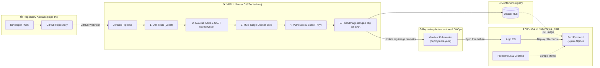

# 💣 Modern Minesweeper — Kubernetes DevSecOps Project

<p align="center">
  <a href="./README.md">English</a> | <strong>Bahasa Indonesia</strong>
</p>

<p align="center">
  
</p>

<p align="center">
  
  
  
  
  
  <br />
  
  
  
  
  
  
</p>

---

## 📌 Ringkasan Project

Repositori ini berisi source code frontend dan konfigurasi CI pipeline untuk setup **Kubernetes DevSecOps** multi-node.

Aplikasi di dalamnya adalah game Minesweeper modern berbasis React 18, TypeScript, dan Tailwind CSS. Aplikasi ini bukan sekadar game biasa, melainkan digunakan sebagai frontend riil untuk menguji seluruh alur deployment: automated testing, code quality & SAST, scanning keamanan container, deployment berbasis GitOps, hingga monitoring di cluster Kubernetes.

---

## 📂 Setup GitOps Dua Repository

Project ini menggunakan pendekatan GitOps dengan memisahkan repository aplikasi dari repository infrastructure & manifest:

```text
┌────────────────────────────────────────────────────────────────────────┐
│                        MODEL GITOPS DUA REPOSITORY                     │
├──────────────────────────────────┬─────────────────────────────────────┤
│ 📦 1. REPOSITORY APLIKASI (INI)  │ ⚙️ 2. REPO INFRASTRUCTURE (TERPISAH)│
├──────────────────────────────────┼─────────────────────────────────────┤
│ • Source code React + TypeScript │ • Script Terraform (Setup VPS)      │
│ • Unit test & coverage (Vitest)  │ • Playbook Ansible (Setup Server)   │
│ • Dockerfile (Multi-stage build) │ • Instalasi cluster K3s             │
│ • Konfigurasi Nginx & SPA routing│ • Manifest YAML Kubernetes          │
│ • Jenkinsfile (CI pipeline)      │ • Konfigurasi aplikasi Argo CD      │
│ • Scanning SonarQube & Trivy     │ • Konfigurasi Prometheus & Grafana  │
└──────────────────────────────────┴─────────────────────────────────────┘
```

- **Repository Aplikasi (`devsecops-minesweeper-typescript` — *Repository Ini*)**:  
  Fokus pada pengembangan aplikasi, unit testing, packaging container Docker, security scan, dan push image terversi (dengan tag Git commit SHA) ke Docker Hub.
- **Repository Infrastructure & GitOps (`devops-infrastructure` — *Repository Terpisah*)**:  
  Fokus pada provisioning VPS dengan Terraform, manajemen konfigurasi server dengan Ansible, manifest Kubernetes (`Deployment`, `Service`, `Ingress`), dan otomatisasi sinkronisasi via Argo CD.

---

## 🏗️ Topologi 3 Node VPS

Project ini berjalan di atas 3 VPS (masing-masing 2 vCPU, 4GB RAM, 60GB SSD dengan OS Ubuntu 24.04 LTS):

| Node | Role | Spesifikasi | Service & Tools Terpasang |
| :--- | :--- | :--- | :--- |
| **VPS 1** | **CI/CD Management** | 2 vCPU · 4 GB RAM | Jenkins, SonarQube + PostgreSQL, Trivy, Docker Engine |
| **VPS 2** | **K8s Control Plane** | 2 vCPU · 4 GB RAM | K3s Server, Kubernetes API Server, Scheduler, Controller Manager, Argo CD |
| **VPS 3** | **K8s Worker Node** | 2 vCPU · 4 GB RAM | K3s Agent, Pod Minesweeper (Nginx), Prometheus, Grafana, Node Exporter |

---

## 🔄 Alur CI/CD & GitOps



### Tahapan Alur Kerja:
1. **Push Code**: Developer melakukan push code ke branch `main`.
2. **Trigger CI**: GitHub Webhook memicu pipeline Jenkins di VPS 1 secara otomatis.
3. **Jalankan Test**: Vitest menjalankan 52 unit/integration test dan menghitung coverage.
4. **Analisis Kualitas & SAST**: SonarQube mengecek kualitas kode berdasarkan quality gate.
5. **Build Container**: Docker mem-build image produksi yang ringan lewat multi-stage build.
6. **Security Scan**: Trivy memindai layer image dan OS package untuk menemukan celah keamanan (CVE).
7. **Push Image**: Image di-push ke Docker Hub menggunakan tag Git commit SHA yang unik.
8. **Update GitOps**: Jenkins memperbarui tag image pada repository infrastructure & GitOps.
9. **Argo CD Sync**: Argo CD mendeteksi perubahan manifest dan melakukan sync otomatis ke cluster K3s.
10. **Monitoring**: Prometheus menarik metrik performa dan Grafana menampilkan dashboard kesehatan pod/node.

---

## 🗺️ Tahapan Implementasi Project

| Level | Area | Tools | Deskripsi |
| :---: | :--- | :--- | :--- |
| **0** | **Infrastructure as Code** | Terraform + Ansible | Otomatisasi setup VPS, konfigurasi SSH, dan bootstrap node cluster K3s |
| **1** | **Containerization** | Docker + Nginx Alpine | Multi-stage build (Node 24 builder → Nginx runtime) dengan routing SPA |
| **2** | **Container Registry** | Docker Hub | Registry image terpusat menggunakan tag Git commit SHA |
| **3** | **CI Pipeline** | Jenkins + Webhook | Pipeline otomatis untuk test, build, dan packaging container |
| **4** | **DevSecOps** | SonarQube + Trivy | Analisis kode statis (SAST) dan scanning kerentanan container |
| **5** | **Kubernetes** | K3s + Ingress Nginx | Manifest deklaratif Deployment, Service, Ingress rules, dan resource limits |
| **6** | **GitOps** | Argo CD | Sinkronisasi otomatis dari repo GitOps dengan self-healing |
| **7** | **Monitoring** | Prometheus + Grafana | Node Exporter, telemetri cluster, dan dashboard metrik aplikasi |

---

## 🐳 Setup Container & Web Server

Aplikasi ini dikontainerisasi menggunakan multi-stage Docker build berbasis Nginx Alpine:

- **Ukuran Sangat Ringkas**: Node.js dan seluruh `node_modules` hanya dipakai saat tahap build. Image produksi final hanya berukuran sekitar **~25 MB**.
- **SPA Routing**: File [nginx/default.conf](./nginx/default.conf) menangani client-side routing dengan konfigurasi `try_files $uri $uri/ /index.html;`.
- **HTTP Caching**: File statis di folder `/assets/` diberi cache jangka panjang (`Cache-Control: public, immutable`), sedangkan file `index.html` tidak di-cache agar user langsung menerima versi terbaru setiap ada deployment baru.

---

## 🎮 Aplikasi Frontend: Modern Minesweeper

Aplikasi yang dipakai sebagai beban kerja project ini dibuat dengan fitur modern:

- 🌐 **Dua Bahasa (EN / ID)**: Tombol pemilih bahasa berbendera (🇬🇧 English / 🇮🇩 Indonesia), default English.
- 📐 **Ukuran Grid Kustom**: Baris dan kolom fleksibel (mulai 4×4 sampai 40×40) dengan pengaturan jumlah ranjau.
- 🎯 **Preset**: Beginner (8×8, 10 ranjau), Intermediate (16×16, 40 ranjau), Expert (16×30, 99 ranjau), dan Kustom.
- 🛡️ **Klik Pertama Aman**: Kotak pertama yang diklik dijamin aman dan langsung membuka area awal.
- ⚡ **Chord Action**: Double-click pada angka yang benderanya sudah pas untuk langsung membuka kotak sekitar.
- ⏱️ **Tampilan LED Digital**: Display 3-digit klasik untuk sisa ranjau dan penghitung waktu.
- 🔊 **Efek Suara**: Audio sintetis via Web Audio API (tanpa perlu aset audio luar) dengan tombol mute.
- 🧪 **Unit Test Lengkap**: 52 unit dan integration test dengan Vitest dan laporan coverage.

---

## 🚀 Menjalankan Project Secara Lokal

### 1. Menjalankan Server Development
```bash
npm run dev
```
Buka `http://localhost:5173` di browser.

### 2. Menjalankan Test & Coverage
```bash
# Menjalankan seluruh unit test
npm test

# Menjalankan test dalam mode watch
npm run test:watch

# Menjalankan laporan coverage
npm run test:coverage
```
Buka laporan HTML coverage: `open coverage/index.html`

### 3. Build & Jalankan Container Lokal
```bash
# Build image Docker
docker build -t minesweeper:local .

# Jalankan container
docker run -d -p 8080:80 --name minesweeper-app minesweeper:local
```
Buka `http://localhost:8080`.

---

## 📁 Struktur Repository

```text
devsecops-minesweeper-typescript/
├── assets/                 # Gambar preview dan diagram
├── nginx/
│   └── default.conf        # Konfigurasi Nginx SPA routing & cache
├── src/
│   ├── components/         # Komponen UI (Board, Cell, Header, Modals, LanguageToggle)
│   ├── types/              # Definisi interface TypeScript
│   ├── utils/              # Logika game, Web Audio, i18n
│   ├── test/               # Setup Vitest dan mock Web Audio
│   ├── __tests__/          # Rangkaian integration test
│   ├── App.tsx             # Root component
│   └── main.tsx            # Entry point DOM
├── coverage/               # Laporan coverage yang di-generate
├── Dockerfile              # Dockerfile multi-stage untuk produksi
├── .dockerignore           # File yang diabaikan saat build Docker
├── vite.config.ts          # Konfigurasi Vite & Vitest
├── package.json            # Dependensi dan script npm
├── README.md               # Dokumentasi Bahasa Inggris
└── README.id.md            # Dokumentasi Bahasa Indonesia (File ini)
```

---

## 🎯 Ringkasan Teknis Komponen Project

| Komponen | Implementasi Teknis |
| :--- | :--- |
| **Aplikasi Frontend** | SPA React 18 + TypeScript dengan 52 unit test Vitest |
| **Container** | Image multi-stage Nginx Alpine minimalis (~25MB) tanpa build tools |
| **CI Pipeline** | Declarative pipeline Jenkins yang dipicu otomatis oleh GitHub Webhook |
| **Security Scan** | Quality gate SonarQube (SAST) dan scanning kerentanan container dengan Trivy |
| **Registry Image** | Docker Hub dengan tag Git commit SHA yang unik dan immutable |
| **GitOps** | Argo CD dengan auto-sync, deteksi drift, dan self-healing |
| **Kubernetes** | Cluster K3s multi-node dengan routing Ingress dan pembatasan resource |
| **Monitoring** | Pengumpulan metrik real-time Prometheus dan dashboard operasional Grafana |
