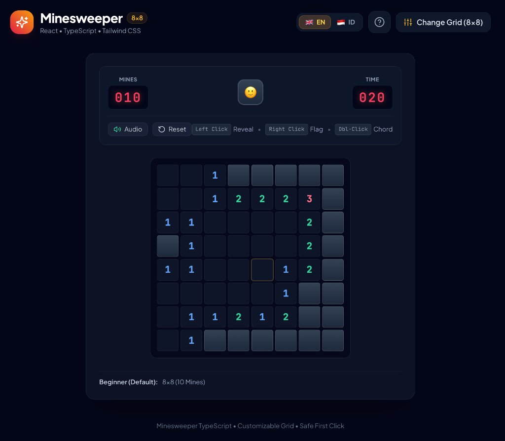

# 💣 Minesweeper Modern (React + TypeScript + Tailwind CSS)

<p align="center">
  <a href="./README.md">English</a> | <strong>Bahasa Indonesia</strong>
</p>

Game Minesweeper modern berbasis web dengan mekanisme klasik, desain neo-retro, kustomisasi ukuran grid (baris & kolom) secara fleksibel, dan konfigurasi default **8x8 (10 ranjau)**.


<p align="center">
  
</p>

---

## ✨ Fitur Utama

- 🌐 **Dukungan Multi-bahasa (EN / ID)**: Alih bahasa antarmuka secara instan melalui tombol bendera (🇬🇧 English / 🇮🇩 Indonesia), dengan **Bahasa Inggris sebagai default**.
- 📐 **Ukuran Grid Kustom**: Bebas mengatur jumlah baris (*row*) dan kolom (*column*) dari 4×4 hingga 40×40 serta mengatur jumlah ranjau sesuai keinginan.
- 🎯 **Preset Kesulitan Standar**:
  - **Pemula (Default)**: 8 × 8 • 10 Ranjau
  - **Menengah**: 16 × 16 • 40 Ranjau
  - **Ahli**: 16 × 30 • 99 Ranjau
  - **Kustom**: Bebas atur ukuran baris, kolom, dan persentase kerapatan ranjau (12% santai, 16% standar, 22% sulit).
- 🛡️ **Jaminan Klik Pertama Selalu Aman (*First-Click Safety*)**: Klik pertama dijamin 100% tidak pernah mengenai ranjau dan otomatis membuka area aman di sekitarnya.
- ⚡ **Chord Action (Double Click / Fast Reveal)**: Double-click atau klik angka yang sudah dikelilingi bendera yang sesuai untuk membuka sisa kotak sekitar secara instan.
- 🚩 **Mode Bendera & Touch Friendly**: Dukungan klik kanan untuk memasang bendera di desktop, serta tombol toggle mode bendera khusus perangkat layar sentuh / mobile.
- ⏱️ **Digital LCD Display**: Tampilan LED 3-digit bergaya retro untuk penghitung waktu dan sisa ranjau.
- 🔊 **Efek Suara Web Audio API**: Sintesis efek suara instan tanpa memerlukan aset audio eksternal (klik, bendera, lepas bendera, ledakan, musik kemenangan) dilengkapi tombol bisukan/audio (*mute*).
- 🎉 **Animasi Kemenangan**: Efek konfeti interaktif (*canvas-confetti*) saat berhasil membuka semua kotak aman.
- 🏆 **Penyimpanan Rekor Terbaik (*High Score*)**: Waktu tercepat disimpan otomatis di `localStorage` untuk setiap ukuran grid.
- 🧪 **Pengujian Menyeluruh (*Unit Testing & Coverage*)**: Dilengkapi lebih dari 50 unit & integration test menggunakan Vitest, React Testing Library, dan laporan cakupan v8.

---

## 🚀 Cara Menjalankan

### 1. Jalankan Server Development

```bash
npm run dev
```

Buka `http://localhost:5173` di browser Anda.

### 2. Jalankan Pengujian (*Unit Testing*) & Coverage

```bash
# Menjalankan seluruh pengujian unit & integrasi
npm test

# Menjalankan pengujian dalam mode interaktif (watch mode)
npm run test:watch

# Menjalankan laporan cakupan kode (CLI table & HTML)
npm run test:coverage
```

Untuk melihat laporan interaktif HTML di browser:

```bash
open coverage/index.html
```

### 3. Build untuk Produksi

```bash
npm run build
```

Hasil build siap rilis akan disimpan di dalam direktori `dist/`.

### 4. Preview Hasil Build

```bash
npm run preview
```

---

## 🎮 Kontrol Permainan

| Aksi | Desktop | Layar Sentuh / Mobile |
| --- | --- | --- |
| **Buka Kotak** | Klik Kiri | Ketuk kotak |
| **Pasang / Lepas Bendera** | Klik Kanan | Aktifkan tombol mode 🚩 lalu ketuk kotak |
| **Chord (Buka Sekitar)** | Double-Click / Klik angka yang sudah cocok benderanya | Ketuk angka |
| **Mulai Ulang** | Klik tombol emoji wajah 🙂 | Ketuk tombol emoji wajah 🙂 |

---

## 📁 Struktur Proyek

```text
devsecops-minesweeper-typescript/
├── assets/                 # Screenshot dan aset visual preview
├── src/
│   ├── components/         # Komponen UI (Board, Cell, Header, Modals, LanguageToggle)
│   ├── types/              # Definisi TypeScript & interface
│   ├── utils/              # Logika matriks game, sintesis audio, kamus i18n
│   ├── test/               # Konfigurasi Vitest dan mock Web Audio
│   ├── __tests__/          # Rangkaian pengujian integrasi aplikasi
│   ├── App.tsx             # Komponen utama permainan
│   └── main.tsx            # Titik masuk aplikasi (entry point)
├── coverage/               # Laporan cakupan pengujian yang di-generate
├── vite.config.ts          # Konfigurasi Vite & Vitest
└── package.json            # Dependensi dan skrip npm
```

