# 💣 Modern Minesweeper — DevSecOps Portfolio

<p align="center">
  <a href="./README.md">English</a> | <strong>Bahasa Indonesia</strong>
</p>

<p align="center">
  
</p>

<p align="center">
  
  
  
  <br />
  
  
  
  
  
  
</p>

---

## 📌 Konteks Proyek: Portofolio Personal DevSecOps

> [!IMPORTANT]
> **Repositori ini BUKAN sekadar aplikasi game Minesweeper biasa.**  
> Repositori ini merupakan **Komponen Aplikasi (*Application Repository*)** dari proyek portofolio **End-to-End Kubernetes DevSecOps (Target Arsitektur Standar Produksi 2026)**.

Game Minesweeper modern (dibangun dengan React 18, TypeScript, Tailwind CSS, dan Vitest) difungsikan sebagai **beban kerja frontend (*workload*) yang interaktif dan realistis**. Aplikasi ini sengaja dirancang untuk mendemonstrasikan dan memvalidasi siklus penuh DevSecOps berstandar enterprise: kontainerisasi, pengujian otomatis, analisis statis (SAST), pemindaian kerentanan keamanan, *continuous delivery* berbasis GitOps, serta *monitoring* pada kluster multi-node Kubernetes.

---

## 📂 Strategi Dua Repositori (GitOps Dual-Repo Model)

Proyek ini menerapkan standar industri pemisahan tanggung jawab (*separation of concerns*) antara repositori kode sumber aplikasi dan repositori deklarasi infrastruktur/deployment:

```
┌────────────────────────────────────────────────────────────────────────┐
│                   MODEL GITOPS DUA REPOSITORI TERPISAH                 │
├──────────────────────────────────┬─────────────────────────────────────┤
│ 📦 REPOSITORI 1 (REPOSI INI)     │ ⚙️ REPOSITORI 2 (REPO TERPISAH)     │
│ Application & CI Pipeline        │ Infrastructure as Code & GitOps     │
├──────────────────────────────────┼─────────────────────────────────────┤
│ • Source Code React + TypeScript │ • Terraform (Provisioning VPS)      │
│ • Unit Tests & Coverage (Vitest) │ • Ansible (Konfigurasi Server)      │
│ • Multi-stage Dockerfile         │ • Setup Kluster K3s (Master/Worker) │
│ • Konfigurasi Produksi Nginx     │ • Manifest Kubernetes (YAML)        │
│ • Definisi Jenkins CI Pipeline   │ • Konfigurasi Argo CD App Sync      │
│ • Pemicu Scan SonarQube & Trivy  │ • Dashboard Prometheus & Grafana    │
└──────────────────────────────────┴─────────────────────────────────────┘
```

- **Repositori 1: Application Repo (`devsecops-minesweeper-typescript` — *Repositori Ini*)**  
  Fokus pada pengembangan fitur aplikasi, pengujian unit otomatis, kontainerisasi multi-stage, pemindaian keamanan kode & kontainer, serta *push* image terversi (dengan tag Git commit SHA) ke Docker Hub.
- **Repositori 2: Infrastructure & GitOps Repo (`devops-infrastructure` — *Repositori Terpisah*)**  
  Fokus pada penyediaan VPS via Terraform, manajemen konfigurasi otomatis dengan Ansible, pemeliharaan berkas manifest Kubernetes (`Deployment`, `Service`, `Ingress`), serta sinkronisasi deployment otomatis menggunakan Argo CD.

---

## 🏗️ Topologi Infrastruktur 3 VPS Standar Produksi

Seluruh infrastruktur berjalan di atas 3 Virtual Private Server (masing-masing 2 vCPU, 4GB RAM, 60GB SSD dengan Ubuntu 24.04 LTS):

| Node | Peran | Spesifikasi | Komponen Terpasang |
| :--- | :--- | :--- | :--- |
| **VPS 1** | **Management & CI/CD** | 2 vCPU · 4 GB RAM · Ubuntu 24.04 | Jenkins Controller & Docker Agent, SonarQube + PostgreSQL, Trivy Scanner, Docker Engine |
| **VPS 2** | **K8s Control Plane** | 2 vCPU · 4 GB RAM · Ubuntu 24.04 | K3s Server, Kubernetes API Server, Scheduler, Controller Manager, Argo CD |
| **VPS 3** | **K8s Worker Node** | 2 vCPU · 4 GB RAM · Ubuntu 24.04 | K3s Agent, Pod Frontend Minesweeper (Nginx), Prometheus, Grafana, Node Exporter |

---

## 🔄 Alur Pipeline DevSecOps End-to-End

```mermaid
flowchart LR
  subgraph AppRepo["📦 Repositori Aplikasi (Repo Ini)"]
    Dev["Developer Push"] --> Git["GitHub Repository"]
  end

  subgraph CIServer["🛠️ VPS 1: Server CI/CD (Jenkins)"]
    Git -->|"GitHub Webhook"| Jenkins["Jenkins Pipeline"]
    Jenkins --> Test["1. Unit Tests & Coverage<br/>(Vitest)"]
    Test --> SAST["2. Kualitas Kode & SAST<br/>(SonarQube)"]
    SAST --> Build["3. Multi-Stage Docker Build<br/>(Node 24 -> Nginx)"]
    Build --> Scan["4. Pemindaian Keamanan & CVE<br/>(Trivy)"]
    Scan --> Push["5. Push Image Terversi<br/>(Docker Hub via Git SHA)"]
  end

  subgraph Registry["🐳 Container Registry"]
    Push --> Reg[("Docker Hub")]
  end

  subgraph GitOpsRepo["⚙️ Repositori Infra & GitOps"]
    Push -->|"Update tag image otomatis"| Manifests["Manifest Kubernetes<br/>(deployment.yaml)"]
  end

  subgraph K8sCluster["☸️ VPS 2 & 3: Kluster Kubernetes (K3s)"]
    Manifests -->|"Deteksi & Sinkron"| Argo["Argo CD Controller"]
    Argo -->|"Reconcile & Deploy"| App["Pod Frontend<br/>(Nginx Alpine)"]
    Reg -.->|"Pull Image"| App
    Prom["Prometheus & Grafana"] -.->|"Metrik & Observabilitas"| App
  end
```



### Tahapan Siklus Pipeline:
1. **Developer Push**: Pengembang melakukan push kode ke branch `main` repositori ini.
2. **Pemicu CI**: GitHub Webhook secara otomatis memicu Declarative Jenkins Pipeline di VPS 1.
3. **Pengujian Otomatis**: Vitest menjalankan 52 unit dan integration test serta memastikan *code coverage*.
4. **Analisis Kualitas & SAST**: SonarQube memverifikasi standar kode dan batas toleransi *quality gate*.
5. **Pembuatan Kontainer**: Docker mengompilasi image multi-stage yang aman, minimalis, dan siap produksi.
6. **Pemindaian Keamanan**: Trivy memindai sistem berkas kontainer dari kerentanan CVE sebelum rilis.
7. **Penyimpanan Image**: Image di-push ke Docker Hub menggunakan tag Git commit SHA yang unik (*immutable*).
8. **Pemicu GitOps**: Jenkins memperbarui tag image pada repositori Infrastructure/GitOps yang terpisah.
9. **Continuous Delivery**: Argo CD mendeteksi perubahan manifest dan menyinkronkan deployment ke kluster K3s secara otomatis.
10. **Observabilitas**: Prometheus mengumpulkan metrik performa dan Grafana menyajikan visualisasi kesehatan aplikasi dan kluster.

---

## 🗺️ Roadmap DevSecOps 8 Tingkat

| Level | Bidang Fokus | Teknologi | Status | Detail Implementasi |
| :---: | :--- | :--- | :---: | :--- |
| **0** | **Infrastructure as Code** | Terraform + Ansible | 🔄 Berjalan | Otomatisasi provisioning VPS dan konfigurasi node server/worker K3s |
| **1** | **Kontainerisasi** | Docker + Nginx Alpine | ✅ Selesai | Multi-stage build (Node.js 24 builder → Nginx runtime) + SPA routing |
| **2** | **Container Registry** | Docker Hub | 🔄 Rencana | Otomatisasi publikasi image dengan penandaan Git SHA yang aman |
| **3** | **CI Pipeline** | Jenkins + Webhook | 🔄 Rencana | Declarative pipeline otomatis untuk build, test, dan packaging |
| **4** | **DevSecOps Security Gate**| SonarQube + Trivy | 🔄 Rencana | Pemeriksaan SAST dan pemindaian kerentanan image sebelum rilis |
| **5** | **Orkestrasi Kubernetes**| K3s + Ingress Nginx | 🔄 Rencana | Deployment, ClusterIP, Ingress, health check, dan resource limits |
| **6** | **GitOps Delivery** | Argo CD | 🔄 Rencana | Sinkronisasi deklaratif GitOps dengan auto-prune dan self-healing |
| **7** | **Monitoring & Alerting** | Prometheus + Grafana | 🔄 Rencana | Telemetri kluster, Node Exporter, dan dasbor lalu lintas frontend |

---

## 🐳 Arsitektur Kontainerisasi Aplikasi

Repositori ini telah mengimplementasikan [Dockerfile](./Dockerfile) multi-stage dan konfigurasi produksi [nginx/default.conf](./nginx/default.conf):

```dockerfile
# Tahap 1: Build & Kompilasi
FROM node:24-alpine3.22 AS builder
WORKDIR /app
COPY package*.json ./
RUN npm ci
COPY . .
RUN npm run build

# Tahap 2: Runtime Produksi Ringan
FROM nginx:stable-alpine
COPY nginx/default.conf /etc/nginx/conf.d/default.conf
COPY --from=builder /app/dist /usr/share/nginx/html
RUN nginx -t
EXPOSE 80
CMD ["nginx", "-g", "daemon off;"]
```

### Keunggulan Desain Ini:
- **Tanpa Node.js di Produksi**: Node.js dan `node_modules` sepenuhnya dibuang setelah build selesai, menyusutkan ukuran image akhir menjadi hanya **~25 MB** dan mengeliminasi kerentanan keamanan runtime Node.js.
- **Mendukung SPA Routing**: Konfigurasi `try_files $uri $uri/ /index.html;` mencegah error 404 saat pengguna me-refresh halaman client-side.
- **Optimalisasi Caching**: Header `Cache-Control: public, immutable` (1 tahun) untuk aset statis berkode hash (`/assets/`) dan `no-cache` untuk `index.html` agar pembaruan rilis langsung tampil ke pengguna.

---

## 🎮 Aplikasi Beban Kerja: Modern Minesweeper

Aplikasi yang digunakan sebagai beban kerja ini dibangun dengan standar kode berkualitas tinggi:

### Fitur Aplikasi
- 🌐 **Dua Bahasa (EN / ID)**: Alih bahasa cepat via tombol bendera (🇬🇧 English / 🇮🇩 Indonesia), default English.
- 📐 **Ukuran Grid Bebas**: Bebas atur baris dan kolom (4×4 hingga 40×40) beserta jumlah ranjau.
- 🎯 **Preset Kesulitan**:
  - **Pemula (Default)**: 8 × 8 • 10 Ranjau
  - **Menengah**: 16 × 16 • 40 Ranjau
  - **Ahli**: 16 × 30 • 99 Ranjau
  - **Kustom**: Dimensi bebas dengan tombol kerapatan (12% santai, 16% standar, 22% sulit).
- 🛡️ **Klik Pertama Aman**: Klik pembuka dijamin 100% aman dan langsung membuka area awal.
- ⚡ **Chord Action**: Double-click angka untuk membuka kotak sekitar yang belum berbendera secara instan.
- ⏱️ **Tampilan LED Digital**: Penghitung waktu dan sisa ranjau bergaya 3-digit LED klasik.
- 🔊 **Audio Web Audio API**: Efek suara sintetis ringan (klik, bendera, bom, menang) + tombol mute.
- 🧪 **Pengujian Menyeluruh**: 52 unit dan integration test dengan laporan cakupan Vitest.

---

## 🚀 Menjalankan Secara Lokal & Pengujian

### 1. Menjalankan Server Development
```bash
npm run dev
```
Buka `http://localhost:5173` di browser.

### 2. Menjalankan Unit Test & Coverage
```bash
# Menjalankan seluruh test
npm test

# Menjalankan test dalam mode watch
npm run test:watch

# Menjalankan laporan coverage (CLI table & HTML)
npm run test:coverage
```
Buka laporan interaktif HTML: `open coverage/index.html`

### 3. Build & Jalankan Kontainer Docker Lokal
```bash
# Build image Docker produksi
docker build -t minesweeper:local .

# Jalankan kontainer
docker run -d -p 8080:80 --name minesweeper-app minesweeper:local
```
Akses aplikasi dalam kontainer di `http://localhost:8080`.

---

## 📁 Struktur Berkas Repositori

```text
devsecops-minesweeper-typescript/
├── assets/                 # Aset visual preview dan arsitektur
├── nginx/
│   └── default.conf        # Konfigurasi Nginx SPA routing & caching produksi
├── src/
│   ├── components/         # Komponen UI (Board, Cell, Header, Modals, LanguageToggle)
│   ├── types/              # Definisi interface & tipe TypeScript
│   ├── utils/              # Logika matriks game, Web Audio, kamus i18n
│   ├── test/               # Setup pengujian Vitest dan mock Web Audio
│   ├── __tests__/          # Rangkaian integration test aplikasi
│   ├── App.tsx             # Komponen utama permainan
│   └── main.tsx            # Titik masuk aplikasi
├── coverage/               # Laporan cakupan kode pengujian
├── Dockerfile              # Berkas build multi-stage Docker produksi
├── .dockerignore           # Berkas yang dikecualikan dari build Docker
├── vite.config.ts          # Konfigurasi Vite & Vitest
├── package.json            # Daftar dependensi dan script npm
├── README.md               # Dokumentasi Bahasa Inggris
└── README.id.md            # Dokumentasi Bahasa Indonesia (Berkas ini)
```

---

## 🎯 Definition of Done (Bukti Kompetensi Portofolio)

Pada akhir implementasi proyek, repositori aplikasi ini bersama repositori infrastruktur pasangannya akan mendemonstrasikan:

| Kemampuan | Bukti Implementasi |
| :--- | :--- |
| **Pengembangan Aplikasi** | SPA modern React + TypeScript dengan 52 unit test yang lolos 100% |
| **Kontainerisasi** | Image Docker multi-stage berukuran sangat ringkas (~25MB) dengan Nginx |
| **Continuous Integration** | Otomatisasi pipeline Jenkins yang dipicu melalui GitHub Webhook |
| **Pemindaian Keamanan** | Analisis SAST SonarQube & pemindaian kerentanan kontainer Trivy |
| **Manajemen Artefak** | Image terversi di Docker Hub dengan tag Git commit SHA yang konsisten |
| **GitOps Delivery** | Argo CD menyinkronkan manifest secara otomatis tanpa `kubectl` manual |
| **Orkestrasi Kubernetes** | High Availability deployment pada kluster K3s multi-node dengan Ingress |
| **Observabilitas** | Pengumpulan metrik real-time Prometheus dan visualisasi dasbor Grafana |
