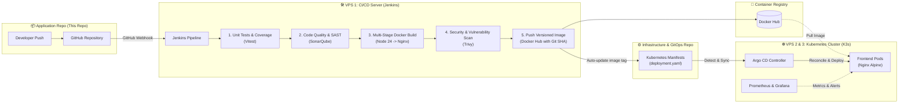

# 💣 Modern Minesweeper — DevSecOps Portfolio

<p align="center">
  <strong>English</strong> | <a href="./README.id.md">Bahasa Indonesia</a>
</p>

<p align="center">
  
</p>

<p align="center">
  
  
  
  <br />
  
  
  
  
  
  
</p>

---

## 📌 Project Context: Personal DevSecOps Portfolio

> [!IMPORTANT]
> **This repository is NOT just a standalone Minesweeper web game.**  
> It is the **Application Component** of an enterprise-grade **End-to-End Kubernetes DevSecOps Portfolio Project (Target: 2026 Production-Ready Architecture)**.

The modern Minesweeper application (built with React 18, TypeScript, Tailwind CSS, and Vitest) serves as a **realistic, interactive frontend workload**. It was engineered to validate and demonstrate a complete production-grade DevSecOps lifecycle: containerization, automated testing, static analysis (SAST), vulnerability scanning, GitOps continuous delivery, and cluster observability across a dedicated multi-VPS infrastructure.

---

## 📂 Dual-Repository GitOps Strategy

This project strictly adheres to the industry-standard **separation of concerns** between application source code and infrastructure/deployment state:

```
┌────────────────────────────────────────────────────────────────────────┐
│                      TWO-REPOSITORY GITOPS MODEL                       │
├──────────────────────────────────┬─────────────────────────────────────┤
│ 📦 REPOSITORY 1 (THIS REPOSITORY)│ ⚙️ REPOSITORY 2 (SEPARATE REPO)     │
│ Application & CI Pipeline        │ Infrastructure & GitOps Manifests   │
├──────────────────────────────────┼─────────────────────────────────────┤
│ • React + TypeScript Source Code │ • Terraform (VPS Provisioning)      │
│ • Unit Tests & Coverage (Vitest) │ • Ansible (Server Configuration)    │
│ • Multi-stage Dockerfile         │ • K3s Cluster Setup                 │
│ • Production Nginx Configuration │ • Kubernetes YAML Manifests         │
│ • Jenkins CI Pipeline definition │ • Argo CD Application Sync Configs  │
│ • SonarQube & Trivy scan trigger │ • Prometheus & Grafana Dashboards   │
└──────────────────────────────────┴─────────────────────────────────────┘
```

- **Repository 1: Application Repo (`devsecops-minesweeper-typescript` — *This Repository*)**  
  Responsible for application feature development, automated testing, multi-stage container packaging, security scanning, and pushing versioned images (tagged with Git commit SHA) to Docker Hub.
- **Repository 2: Infrastructure & GitOps Repo (`devops-infrastructure` — *Separate Repository*)**  
  Responsible for provisioning VPS instances via Terraform, configuring servers with Ansible, maintaining declarative Kubernetes manifests (`Deployment`, `Service`, `Ingress`), and managing continuous delivery via Argo CD.

---

## 🏗️ 3-Node VPS Infrastructure Topology

The production-like environment is deployed across three dedicated Virtual Private Servers (2 vCPU, 4GB RAM, 60GB SSD each on Ubuntu 24.04 LTS):

| Node | Role | Specifications | Installed Components |
| :--- | :--- | :--- | :--- |
| **VPS 1** | **Management & CI/CD** | 2 vCPU · 4 GB RAM · Ubuntu 24.04 | Jenkins Controller & Agent, SonarQube + PostgreSQL, Trivy Scanner, Docker Engine |
| **VPS 2** | **K8s Control Plane** | 2 vCPU · 4 GB RAM · Ubuntu 24.04 | K3s Server, Kubernetes API Server, Scheduler, Controller Manager, Argo CD |
| **VPS 3** | **K8s Worker Node** | 2 vCPU · 4 GB RAM · Ubuntu 24.04 | K3s Agent, Minesweeper Frontend Pods (Nginx), Prometheus, Grafana, Node Exporter |

---

## 🔄 End-to-End DevSecOps Pipeline Flow



### Pipeline Lifecycle Breakdown:
1. **Developer Push**: Code pushed to `main` branch in this repository.
2. **CI Trigger**: GitHub Webhook triggers the declarative Jenkins pipeline on VPS 1.
3. **Automated Testing**: Vitest runs 52 unit/integration tests with coverage enforcement.
4. **Code Quality & SAST**: SonarQube validates code health and checks against quality gates.
5. **Container Build**: Docker builds a minimal, production-hardened multi-stage container image.
6. **Security Scanning**: Trivy scans container filesystem and dependencies for CVEs before release.
7. **Image Registry**: Secure image is pushed to Docker Hub with an immutable Git commit SHA tag.
8. **GitOps Trigger**: Jenkins commits the new image tag into the separate Infrastructure/GitOps repository.
9. **Continuous Delivery**: Argo CD detects the git commit and automatically reconciles changes to the K3s cluster.
10. **Observability**: Prometheus collects metrics, while Grafana visualizes application availability and cluster health.

---

## 🗺️ 8-Stage DevSecOps Implementation Roadmap

| Level | Focus Area | Technology Stack | Status | Implementation Details |
| :---: | :--- | :--- | :---: | :--- |
| **0** | **Infrastructure as Code** | Terraform + Ansible | 🔄 In Progress | Automated VPS provisioning and K3s server/worker node configuration |
| **1** | **Containerization** | Docker + Nginx Alpine | ✅ Done | Multi-stage build (Node.js 24 builder → Nginx runtime) with SPA routing |
| **2** | **Container Registry** | Docker Hub | 🔄 Planned | Automated image publishing using immutable Git SHA tagging |
| **3** | **CI Pipeline** | Jenkins + GitHub Webhooks | 🔄 Planned | Declarative pipeline executing build, test, and container packaging |
| **4** | **DevSecOps Security Gate**| SonarQube + Trivy | 🔄 Planned | SAST code analysis and vulnerability scanning blocking vulnerable images |
| **5** | **Kubernetes Orchestration**| K3s + Ingress Nginx | 🔄 Planned | Deployment, ClusterIP Service, Ingress, health checks, resource limits |
| **6** | **GitOps Continuous Delivery**| Argo CD | 🔄 Planned | Declarative GitOps synchronization with auto-prune and self-healing |
| **7** | **Observability & Monitoring**| Prometheus + Grafana | 🔄 Planned | Cluster telemetry, Node Exporter, and frontend traffic dashboards |

---

## 🐳 Application Containerization Architecture

This repository includes a multi-stage [Dockerfile](./Dockerfile) and production [nginx/default.conf](./nginx/default.conf) designed specifically for enterprise workloads:

```dockerfile
# Stage 1: Build & Compile
FROM node:24-alpine3.22 AS builder
WORKDIR /app
COPY package*.json ./
RUN npm ci
COPY . .
RUN npm run build

# Stage 2: Minimal Production Runtime
FROM nginx:stable-alpine
COPY nginx/default.conf /etc/nginx/conf.d/default.conf
COPY --from=builder /app/dist /usr/share/nginx/html
RUN nginx -t
EXPOSE 80
CMD ["nginx", "-g", "daemon off;"]
```

### Why this design?
- **Zero Node.js Runtime in Production**: Node.js and `node_modules` are completely discarded after build, reducing the final image size to **~25 MB** and eliminating runtime Node.js vulnerabilities.
- **SPA Routing Support**: Configured with `try_files $uri $uri/ /index.html;` to ensure client-side routes never return 404.
- **Optimized Caching**: Long-term immutable caching (`Cache-Control: public, immutable`) for hashed static assets (`/assets/`) and `no-cache` for `index.html` to guarantee instant deployment rollouts.

---

## 🎮 The Workload Application: Modern Minesweeper

While the primary goal of this repository is DevSecOps automation, the application itself is built with production standards:

### Key Application Features
- 🌐 **Bilingual (EN / ID)**: Instant language switching via flag buttons (🇬🇧 English / 🇮🇩 Indonesia), with English as default.
- 📐 **Customizable Grid**: Freely configure rows and columns (4×4 to 40×40) with custom mine counts.
- 🎯 **Standard Presets**:
  - **Beginner (Default)**: 8 × 8 • 10 Mines
  - **Intermediate**: 16 × 16 • 40 Mines
  - **Expert**: 16 × 30 • 99 Mines
  - **Custom**: Custom dimensions and density presets (12% relaxed, 16% standard, 22% hard).
- 🛡️ **First-Click Safety**: Initial click is guaranteed safe and automatically clears an open starting area.
- ⚡ **Chord Action**: Double-click or click revealed numbers with matching flags to open remaining neighbors.
- ⏱️ **Digital LED Display**: Classic 3-digit LED displays for timer and remaining mine counter.
- 🔊 **Synthesized Web Audio**: Lightweight procedural audio (click, flag, boom, win fanfare) with mute toggle.
- 🧪 **Test Suite**: 52 unit/integration tests with comprehensive coverage reports.

---

## 🚀 Local Development & Testing

### 1. Run Development Server
```bash
npm run dev
```
Open `http://localhost:5173` in your browser.

### 2. Run Unit Tests & Check Coverage
```bash
# Run all unit and integration tests
npm test

# Run tests in interactive watch mode
npm run test:watch

# Generate code coverage report (CLI table & HTML)
npm run test:coverage
```
View HTML report: `open coverage/index.html`

### 3. Build & Test Container Locally
```bash
# Build production Docker image
docker build -t minesweeper:local .

# Run containerized application
docker run -d -p 8080:80 --name minesweeper-app minesweeper:local
```
Access the containerized app at `http://localhost:8080`.

---

## 📁 Repository Structure

```text
devsecops-minesweeper-typescript/
├── assets/                 # Preview screenshots and architecture assets
├── nginx/
│   └── default.conf        # Production Nginx SPA routing & caching config
├── src/
│   ├── components/         # UI Components (Board, Cell, Header, Modals, LanguageToggle)
│   ├── types/              # TypeScript definitions & interfaces
│   ├── utils/              # Game algorithms, audio synthesis, i18n
│   ├── test/               # Vitest test setup and Web Audio mocks
│   ├── __tests__/          # Integration test suites
│   ├── App.tsx             # Application root
│   └── main.tsx            # DOM Entry point
├── coverage/               # Generated test coverage reports
├── Dockerfile              # Production multi-stage Docker build
├── .dockerignore           # Docker build exclusions
├── vite.config.ts          # Vite & Vitest configuration
├── package.json            # Project dependencies and scripts
├── README.md               # English Documentation (This file)
└── README.id.md            # Bahasa Indonesia Documentation
```

---

## 🎯 Definition of Done (Portfolio Showcase)

At the conclusion of this project, this repository and its companion infrastructure repository will demonstrate:

| Capability | Demonstration Proof |
| :--- | :--- |
| **Application Development** | Responsive React + TypeScript SPA with 52 passing unit tests |
| **Containerization** | Production-ready, multi-stage Docker image (~25MB) running Nginx |
| **Continuous Integration** | Automated Jenkins pipeline triggered via GitHub Webhooks |
| **Security Scanning** | SonarQube SAST Quality Gate & Trivy Container vulnerability enforcement |
| **Artifact Management** | Versioned images pushed to Docker Hub with immutable Git SHA tags |
| **GitOps Delivery** | Argo CD automatically reconciling changes without manual `kubectl` |
| **Kubernetes Orchestration** | High-availability deployment on a multi-node K3s cluster with Ingress |
| **Observability** | Real-time Prometheus metrics and Grafana monitoring dashboards |
