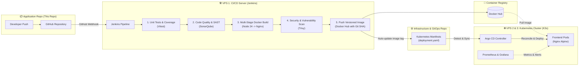

# 💣 Modern Minesweeper — Cloud-Native DevSecOps Project

<p align="center">
  <strong>English</strong> | <a href="./README.id.md">Bahasa Indonesia</a>
</p>

<p align="center">
  
</p>

<p align="center">
  
  
  
  <br />
  
  
  
  
  
  
</p>

---

## 📌 Project Overview

This repository hosts the **Application Service** of an enterprise-grade, cloud-native **Kubernetes DevSecOps Project**.

While serving an interactive, feature-rich web application built with modern React 18, TypeScript, and Tailwind CSS, this codebase is engineered specifically to operate as a production workload within a complete DevSecOps ecosystem. It integrates automated testing, containerization, static application security testing (SAST), vulnerability scanning, GitOps continuous delivery, and cluster observability across dedicated multi-node cloud infrastructure.

---

## 📂 Dual-Repository GitOps Architecture

This system enforces strict **separation of concerns** between application source code and deployment/infrastructure configurations through a decoupled two-repository model:

```
┌────────────────────────────────────────────────────────────────────────┐
│                      TWO-REPOSITORY GITOPS MODEL                       │
├──────────────────────────────────┬─────────────────────────────────────┤
│ 📦 APPLICATION REPO (THIS REPO)  │ ⚙️ INFRASTRUCTURE & GITOPS REPO     │
│ Application Service & CI Pipeline│ Infrastructure as Code & GitOps     │
├──────────────────────────────────┼─────────────────────────────────────┤
│ • React + TypeScript Source Code │ • Terraform (Infrastructure IaC)    │
│ • Unit Tests & Coverage (Vitest) │ • Ansible (System Configuration)    │
│ • Production Container Packaging │ • K3s Multi-node Cluster Setup      │
│ • Nginx Web Server Configuration │ • Kubernetes Declarative Manifests  │
│ • Declarative CI Pipeline        │ • Argo CD GitOps Synchronization    │
│ • Automated Security Scanning    │ • Prometheus & Grafana Observability│
└──────────────────────────────────┴─────────────────────────────────────┘
```

- **Application Repository (`devsecops-minesweeper-typescript` — *This Repository*)**  
  Responsible for core application development, comprehensive unit testing, multi-stage container packaging, security scanning, and pushing versioned images (tagged with Git commit SHA) to Docker Hub.
- **Infrastructure & GitOps Repository (`devops-infrastructure` — *Separate Repository*)**  
  Responsible for provisioning VPS instances via Terraform, automating server setup with Ansible, maintaining declarative Kubernetes manifests (`Deployment`, `Service`, `Ingress`), and managing continuous delivery through Argo CD.

---

## 🏗️ Infrastructure Topology

The production environment runs across three dedicated cloud nodes (each provisioned with 2 vCPU, 4GB RAM, and 60GB SSD running Ubuntu 24.04 LTS):

| Node | Role | Specifications | Installed Services & Components |
| :--- | :--- | :--- | :--- |
| **VPS 1** | **Management & CI/CD** | 2 vCPU · 4 GB RAM · Ubuntu 24.04 | Jenkins Controller & Docker Agent, SonarQube + PostgreSQL, Trivy Security Scanner, Docker Engine |
| **VPS 2** | **K8s Control Plane** | 2 vCPU · 4 GB RAM · Ubuntu 24.04 | K3s Server, Kubernetes API Server, Scheduler, Controller Manager, Argo CD |
| **VPS 3** | **K8s Worker Node** | 2 vCPU · 4 GB RAM · Ubuntu 24.04 | K3s Agent, Frontend Application Pods (Nginx), Prometheus, Grafana, Node Exporter |

---

## 🔄 End-to-End DevSecOps Pipeline Flow



### Pipeline Lifecycle Stages:
1. **Source Code Commit**: Developer pushes changes to the `main` branch.
2. **Automated CI Trigger**: GitHub Webhook triggers the declarative Jenkins pipeline on VPS 1.
3. **Automated Testing**: Vitest runs 52 unit/integration tests with code coverage verification.
4. **Code Quality & SAST**: SonarQube evaluates code quality and verifies quality gates.
5. **Container Build**: Docker packages the static build into a production-grade Alpine Nginx container.
6. **Security Scanning**: Trivy inspects container layers and OS packages for vulnerabilities (CVEs).
7. **Artifact Publishing**: The verified image is published to Docker Hub with an immutable Git commit SHA tag.
8. **GitOps Trigger**: Jenkins commits the updated image tag into the separate Infrastructure/GitOps repository.
9. **Continuous Delivery**: Argo CD detects manifest changes and reconciles deployment on the K3s cluster.
10. **Cluster Telemetry**: Prometheus collects performance metrics, and Grafana visualizes system health.

---

## 🗺️ DevSecOps Architecture Stages

| Stage | Focus Area | Technology Stack | Scope & Implementation Details |
| :---: | :--- | :--- | :--- |
| **0** | **Infrastructure as Code** | Terraform + Ansible | Automated VPS provisioning, SSH security, and K3s cluster node bootstrap |
| **1** | **Containerization** | Docker + Nginx Alpine | Multi-stage container packaging, non-root execution, SPA routing, and caching |
| **2** | **Container Registry** | Docker Hub | Centralized image storage using immutable Git commit SHA tagging |
| **3** | **CI Pipeline** | Jenkins + Webhooks | Declarative pipeline executing automated build, test, and container packaging |
| **4** | **DevSecOps Security** | SonarQube + Trivy | Static application security testing (SAST) and container vulnerability scanning |
| **5** | **Kubernetes Orchestration** | K3s + Ingress Nginx | Declarative Deployments, Services, Ingress, health checks, and resource limits |
| **6** | **GitOps Delivery** | Argo CD | Declarative GitOps reconciliation with automated drift detection and self-healing |
| **7** | **Observability & Monitoring** | Prometheus + Grafana | Cluster telemetry, Node Exporter, workload metrics, and operational dashboards |

---

## 🐳 Containerization & Web Server

The application is containerized using a multi-stage process that separates the build environment from the production runtime:

- **Minimal Footprint**: Node.js and dependencies are discarded after build, producing an Alpine Nginx image of **~25 MB**.
- **SPA Routing**: Production [nginx/default.conf](./nginx/default.conf) handles client-side routing via `try_files $uri $uri/ /index.html;`.
- **HTTP Caching**: Static hashed assets (`/assets/`) receive long-term immutable caching (`Cache-Control: public, immutable`), while `index.html` remains uncached to ensure instant deployment updates.

---

## 🎮 Application Specifications: Modern Minesweeper

The workload is a responsive, feature-complete web game developed with modern web standards:

### Key Features
- 🌐 **Bilingual (EN / ID)**: Instant language switching via flag buttons (🇬🇧 English / 🇮🇩 Indonesia), with English as default.
- 📐 **Customizable Grid**: Flexible configuration of rows and columns (4×4 to 40×40) with adjustable mine density.
- 🎯 **Difficulty Presets**:
  - **Beginner (Default)**: 8 × 8 • 10 Mines
  - **Intermediate**: 16 × 16 • 40 Mines
  - **Expert**: 16 × 30 • 99 Mines
  - **Custom**: Custom dimensions with density shortcuts (12% relaxed, 16% standard, 22% hard).
- 🛡️ **Guaranteed First-Click Safety**: Initial click is guaranteed safe and automatically clears an open starting area.
- ⚡ **Chord Action**: Double-click or click revealed numbers with matching flags to open remaining neighbors.
- ⏱️ **Digital LED Display**: Classic 3-digit LED displays for timer and remaining mine counter.
- 🔊 **Synthesized Audio**: Lightweight Web Audio API synthesis (click, flag, detonation, victory) with mute toggle.
- 🧪 **Unit Testing**: 52 unit and integration tests with coverage reporting.

---

## 🚀 Local Development & Testing

### 1. Run Development Server
```bash
npm run dev
```
Access at `http://localhost:5173`.

### 2. Run Unit Tests & Check Coverage
```bash
# Run all unit and integration tests
npm test

# Run tests in interactive watch mode
npm run test:watch

# Generate code coverage report (CLI table & HTML)
npm run test:coverage
```
View HTML report: `open coverage/index.html`

### 3. Build & Run Container Locally
```bash
# Build production Docker image
docker build -t minesweeper:local .

# Run containerized application
docker run -d -p 8080:80 --name minesweeper-app minesweeper:local
```
Access the containerized app at `http://localhost:8080`.

---

## 📁 Repository Structure

```text
devsecops-minesweeper-typescript/
├── assets/                 # Visual preview and architecture assets
├── nginx/
│   └── default.conf        # Production Nginx SPA routing & caching config
├── src/
│   ├── components/         # UI Components (Board, Cell, Header, Modals, LanguageToggle)
│   ├── types/              # TypeScript definitions & interfaces
│   ├── utils/              # Game algorithms, audio synthesis, i18n
│   ├── test/               # Vitest test setup and Web Audio mocks
│   ├── __tests__/          # Integration test suites
│   ├── App.tsx             # Application root
│   └── main.tsx            # DOM Entry point
├── coverage/               # Generated test coverage reports
├── Dockerfile              # Production multi-stage Docker build
├── .dockerignore           # Docker build exclusions
├── vite.config.ts          # Vite & Vitest configuration
├── package.json            # Project dependencies and scripts
├── README.md               # English Documentation (This file)
└── README.id.md            # Bahasa Indonesia Documentation
```

---

## 🎯 Production Engineering Standards

| Dimension | Implementation Standard |
| :--- | :--- |
| **Application Layer** | Responsive React + TypeScript SPA with 52 passing unit tests |
| **Containerization** | Minimal, multi-stage Alpine Nginx container (~25MB) with zero build tools |
| **Continuous Integration** | Automated Jenkins pipeline triggered via GitHub Webhooks |
| **Security Scanning** | SonarQube SAST Quality Gate & Trivy Container vulnerability enforcement |
| **Artifact Management** | Versioned images pushed to Docker Hub with immutable Git SHA tags |
| **GitOps Delivery** | Argo CD automated reconciliation with drift detection and self-healing |
| **Kubernetes Orchestration** | High-availability multi-node K3s cluster deployment with Ingress routing |
| **Observability** | Prometheus real-time metrics collection and Grafana operational dashboards |
