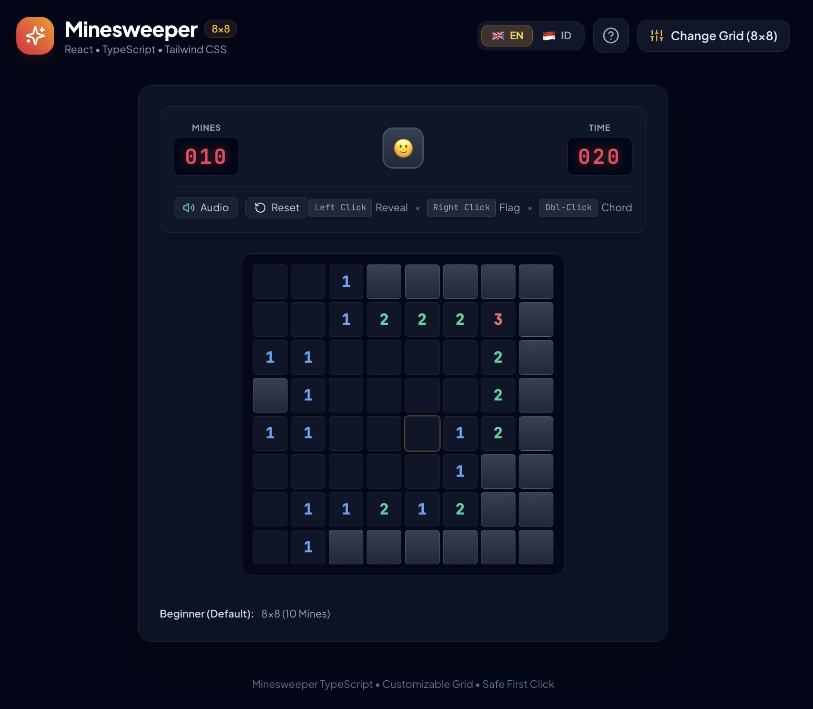
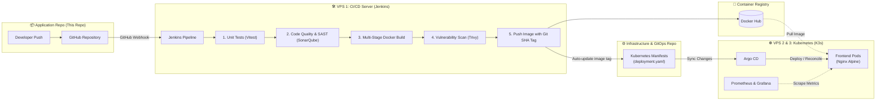

# 💣 Modern Minesweeper — Kubernetes DevSecOps Project

<p align="center">
  <strong>English</strong> | <a href="./README.id.md">Bahasa Indonesia</a>
</p>

<p align="center">
  
</p>

<p align="center">
  
  
  
  
  
  <br />
  
  
  
  
  
  
</p>

---

## 📌 Project Overview

This repository contains the frontend application and CI pipeline configuration for a multi-node **Kubernetes DevSecOps Project**.

The application itself is a modern, responsive Minesweeper web game built with React 18, TypeScript, and Tailwind CSS. Rather than being just a standalone game, it serves as the practical frontend workload to implement and test a complete deployment workflow: automated testing, static code analysis (SAST), container security scanning, GitOps-based deployment, and cluster monitoring.

---

## 📂 Two-Repository GitOps Setup

The project uses a decoupled GitOps architecture that separates the application codebase from the infrastructure and deployment configurations:

```text
┌────────────────────────────────────────────────────────────────────────┐
│                        TWO-REPOSITORY GITOPS MODEL                     │
├──────────────────────────────────┬─────────────────────────────────────┤
│ 📦 1. APPLICATION REPO (THIS)    │ ⚙️ 2. INFRASTRUCTURE REPO (SEPARATE)│
├──────────────────────────────────┼─────────────────────────────────────┤
│ • React + TypeScript source code │ • Terraform configs (VPS setup)     │
│ • Vitest unit tests & coverage   │ • Ansible playbooks (Server setup)  │
│ • Multi-stage Dockerfile         │ • K3s cluster installation (Server) │
│ • Nginx configuration & SPA rules│ • Kubernetes YAML manifests (App)   │
│ • Jenkinsfile (CI pipeline)      │ • Argo CD application configs       │
│ • SonarQube & Trivy scan steps   │ • Prometheus & Grafana configs      │
└──────────────────────────────────┴─────────────────────────────────────┘
```

- **Application Repo (`devsecops-minesweeper-typescript` — *This repository*)**:  
  Handles application development, unit tests, Docker packaging, security scans, and pushing versioned images (tagged with Git commit SHA) to Docker Hub.
- **Infrastructure & GitOps Repo (`devops-infrastructure` — *Separate repository*)**:  
  Handles server provisioning via Terraform, configuration management via Ansible, declarative Kubernetes manifests (`Deployment`, `Service`, `Ingress`), and GitOps synchronization via Argo CD.

---

## 🏗️ 3-Node VPS Topology

The project runs on three VPS nodes (each with 2 vCPU, 4GB RAM, 60GB SSD on Ubuntu 24.04 LTS):

| Node | Role | Specs | Services & Tools |
| :--- | :--- | :--- | :--- |
| **VPS 1** | **CI/CD Management** | 2 vCPU · 4 GB RAM | Jenkins, SonarQube + PostgreSQL, Trivy, Docker Engine |
| **VPS 2** | **K8s Control Plane** | 2 vCPU · 4 GB RAM | K3s Server, Kubernetes API, Scheduler, Controller Manager, Argo CD |
| **VPS 3** | **K8s Worker Node** | 2 vCPU · 4 GB RAM | K3s Agent, Minesweeper Pods (Nginx), Prometheus, Grafana, Node Exporter |

---

## 🔄 CI/CD & GitOps Workflow



### Workflow Steps:
1. **Push Code**: Code is pushed to the `main` branch.
2. **CI Trigger**: GitHub Webhook triggers the Jenkins pipeline on VPS 1.
3. **Run Tests**: Vitest runs all 52 unit/integration tests and generates coverage reports.
4. **Code Quality & SAST**: SonarQube checks code health against quality gates.
5. **Container Build**: Docker builds a lightweight production image using a multi-stage process.
6. **Security Scan**: Trivy scans container layers and packages for CVEs.
7. **Push to Registry**: Image is pushed to Docker Hub with an immutable Git commit SHA tag.
8. **GitOps Update**: Jenkins updates the image tag in the separate Infrastructure/GitOps repository.
9. **Argo CD Sync**: Argo CD detects the updated manifest and syncs the changes to the K3s cluster.
10. **Monitoring**: Prometheus collects runtime metrics and Grafana visualizes node and pod health.

---

## 🗺️ Project Implementation Stages

| Level | Area | Tools | Description |
| :---: | :--- | :--- | :--- |
| **0** | **Infrastructure as Code** | Terraform + Ansible | Automated VPS setup, SSH access, and K3s node configuration |
| **1** | **Containerization** | Docker + Nginx Alpine | Multi-stage build (Node 24 builder → Nginx runtime) with SPA routing |
| **2** | **Container Registry** | Docker Hub | Central image registry using Git commit SHA tags |
| **3** | **CI Pipeline** | Jenkins + Webhook | Automated pipeline for test, build, and packaging |
| **4** | **DevSecOps** | SonarQube + Trivy | Static application security testing (SAST) and container vulnerability scanning |
| **5** | **Kubernetes** | K3s + Ingress Nginx | Declarative Deployments, Services, Ingress rules, and resource limits |
| **6** | **GitOps** | Argo CD | Automated sync from the GitOps repo with self-healing |
| **7** | **Monitoring** | Prometheus + Grafana | Node Exporter, cluster telemetry, and application dashboards |

---

## 🐳 Container Setup & Web Server

The application uses a multi-stage Docker build with Nginx Alpine:

- **Small Footprint**: Node.js and dependencies are only used during the build stage. The final production image is ~25 MB.
- **SPA Routing**: The [nginx/default.conf](./nginx/default.conf) file handles client-side routing with `try_files $uri $uri/ /index.html;`.
- **HTTP Caching**: Static assets in `/assets/` have long-term immutable cache headers, while `index.html` is not cached so new deployments load immediately.

---

## 🎮 The Frontend Application: Modern Minesweeper

The application used as the project's frontend workload includes:

- 🌐 **Bilingual (EN / ID)**: Language switcher with flag buttons (🇬🇧 English / 🇮🇩 Indonesia), default is English.
- 📐 **Custom Grid Size**: Adjustable rows and columns (from 4×4 to 40×40) with custom mine counts.
- 🎯 **Presets**: Beginner (8×8, 10 mines), Intermediate (16×16, 40 mines), Expert (16×30, 99 mines), and Custom.
- 🛡️ **First-Click Safety**: The first click is guaranteed safe and opens a starting area.
- ⚡ **Chord Action**: Double-click or click on revealed numbers with matching flags to open neighboring cells.
- ⏱️ **Digital LCD Display**: 3-digit retro displays for remaining mines and elapsed time.
- 🔊 **Sound Effects**: Synthesized audio via Web Audio API (no external sound files required) with a mute toggle.
- 🧪 **Unit Tests**: 52 unit/integration tests with Vitest and coverage reporting.

---

## 🚀 Local Development & Testing

### 1. Run Development Server
```bash
npm run dev
```
Open `http://localhost:5173` in your browser.

### 2. Run Tests & Check Coverage
```bash
# Run all unit tests
npm test

# Run tests in watch mode
npm run test:watch

# Generate coverage report
npm run test:coverage
```
Open HTML coverage report: `open coverage/index.html`

### 3. Build & Run Container Locally
```bash
# Build Docker image
docker build -t minesweeper:local .

# Run container
docker run -d -p 8080:80 --name minesweeper-app minesweeper:local
```
Open `http://localhost:8080`.

---

## 📁 Repository Structure

```text
devsecops-minesweeper-typescript/
├── assets/                 # App preview images and diagrams
├── nginx/
│   └── default.conf        # Production Nginx SPA routing and cache rules
├── src/
│   ├── components/         # UI components (Board, Cell, Header, Modals, LanguageToggle)
│   ├── types/              # TypeScript interfaces
│   ├── utils/              # Game logic, Web Audio, i18n
│   ├── test/               # Vitest setup and Web Audio mocks
│   ├── __tests__/          # Integration test suites
│   ├── App.tsx             # Root component
│   └── main.tsx            # Entry point
├── coverage/               # Generated test coverage reports
├── Dockerfile              # Multi-stage production Dockerfile
├── .dockerignore           # Docker build ignore rules
├── vite.config.ts          # Vite & Vitest config
├── package.json            # Dependencies and npm scripts
├── README.md               # English documentation
└── README.id.md            # Bahasa Indonesia documentation
```

---

## 🎯 Technical Summary

| Component | Technical Implementation |
| :--- | :--- |
| **Frontend App** | React 18 + TypeScript SPA with 52 passing Vitest unit tests |
| **Container** | Multi-stage Alpine Nginx image (~25MB) with zero build dependencies |
| **CI Pipeline** | Jenkins declarative pipeline triggered via GitHub Webhook |
| **Security Scanning** | SonarQube SAST quality gate and Trivy container vulnerability scan |
| **Image Registry** | Docker Hub repository tagged with immutable Git commit SHAs |
| **GitOps** | Argo CD automated sync, drift detection, and self-healing |
| **Kubernetes** | Multi-node K3s cluster with Ingress routing and resource limits |
| **Monitoring** | Prometheus metrics collection and Grafana operational dashboards |
